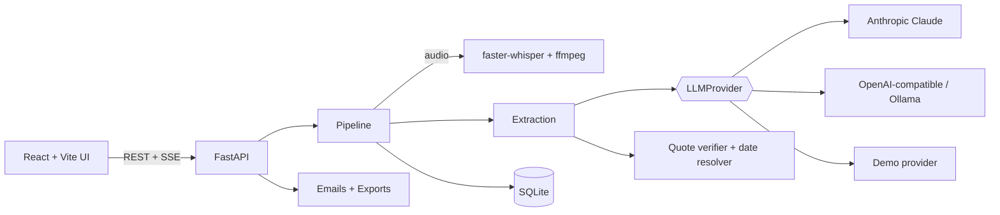

# ActionLoop

> **Turn messy meetings into finished follow-through.** Paste a transcript or drop in a recording and get decisions, an owner-assigned Kanban board, ready-to-send follow-up emails, and calendar/CSV/Slack exports, with every claim backed by a verified quote.

Built for the **Creators AI Winter Challenge** (Devpost). Runs **fully offline in demo mode: no API key, no internet, no cost.**


<!-- GIF placeholder: docs/screenshots/demo.gif -->

## Problem

Meetings end with good intentions and no follow-through. Someone has to re-listen, write notes, work out who agreed to what, convert "by Friday" into a date, chase the unclear items and write the emails. Students, club leads, startups and small teams rarely have that someone.

## Solution

ActionLoop does the whole loop:

1. **Transcribe** audio/video locally with Whisper (or paste text).
2. **Extract** a summary, decisions, action items (owner, deadline, priority), open questions and risks, as strict, validated JSON.
3. **Verify**: every decision and task carries a verbatim evidence quote that the app checks against the transcript. Unverifiable items get a warning badge instead of being silently trusted.
4. **Organise**: a drag-and-drop Kanban board, a "Needs clarification" panel for missing owners and deadlines, and workload per person.
5. **Follow up**: a team recap plus one personalised email per owner, in three tones. Drafts only, and nothing is ever sent.
6. **Export**: Markdown, CSV, ICS, Slack/Teams text, JSON, ZIP, and a shareable read-only report page.

## Features

| Area | What you get |
|---|---|
| Input | Paste transcript, upload mp3/wav/m4a/mp4/webm (≤100 MB), or one-click bundled samples. Title, date, attendees and timezone. |
| Progress | Live Transcribing → Analyzing → Drafting emails → Done via Server-Sent Events. |
| Transcript | Interactive viewer; `Name:` speaker prefixes are parsed, otherwise speakers stay unknown (never invented). Click any evidence quote to jump to and highlight its segment. |
| Extraction | Pydantic-validated schema, up to 2 retries with the validation error fed back, chunking with overlap and merge/dedupe for long meetings. |
| Dates | Relative deadlines ("by Friday", "end of the month", "week after next") are resolved **in code** against the meeting date. The original wording is kept. |
| Board | Drag-and-drop (mouse and keyboard) persisted in SQLite, edit/add/delete, owner filter, search, overdue (red) and due-soon (amber) chips. |
| Emails | Recap and per-owner drafts, Professional/Friendly/Concise, editable, plain text + HTML preview, Copy, `mailto:`. |
| Exports | `.md`, `.csv`, `.ics` (all-day event per dated task), Slack text, `.json`, ZIP, and `/m/{id}` shareable report. |
| History | Sidebar with open/rename/delete, plus open and overdue task counts. |
| Extras | Dark mode, toasts, skeletons, empty states, keyboard shortcuts (`/` search, `n` new task, `1`-`5` tabs), workload chart. |

<!-- Screenshots: docs/screenshots/board.png, emails.png, transcript.png -->

## Architecture



More detail in [docs/architecture.md](docs/architecture.md).

## Tech stack

Python 3.11+, FastAPI, Pydantic v2, SQLModel/SQLite, faster-whisper, ffmpeg, dateparser, RapidFuzz · React 18, Vite, TypeScript, Tailwind CSS, @dnd-kit · pytest, Vitest · Docker.

## Quick start (demo mode, no keys)

### Option A: Docker

```bash
git clone https://github.com/Vasu-uu/ActionLoop.git && cd ActionLoop
docker compose up --build
# open http://localhost:8000
```

### Option B: local (Python 3.11+, Node 18+, ffmpeg for audio)

macOS/Linux:

```bash
make setup      # venv + deps
make run        # builds the UI and serves everything on http://localhost:8000
# development with hot reload: make backend  (terminal 1)  and  make frontend  (terminal 2, http://localhost:5173)
```

Windows (no `make` needed):

```powershell
.\scripts\dev.ps1 setup
.\scripts\dev.ps1 run     # http://localhost:8000
# or hot reload: .\scripts\dev.ps1 dev   (API :8000 + UI :5173)
```

Open the app, choose **Try a sample → Load & analyze**.

### Use a real model (optional)

Copy `.env.example` to `.env` and set one of:

```bash
LLM_PROVIDER=anthropic   ANTHROPIC_API_KEY=...        # Claude
LLM_PROVIDER=openai      OPENAI_API_KEY=...           # OpenAI (or any OpenAI-compatible URL via OPENAI_BASE_URL)
LLM_PROVIDER=ollama      OLLAMA_MODEL=llama3.1        # fully local; run `ollama pull llama3.1` first
```

The active provider and a privacy note are always shown in the sidebar.

## Configuration

| Variable | Default | Purpose |
|---|---|---|
| `LLM_PROVIDER` | auto | `anthropic` \| `openai` \| `ollama` \| `demo`. Empty picks a provider whose key is set, else `demo`. |
| `ANTHROPIC_API_KEY` / `ANTHROPIC_MODEL` | – / `claude-opus-5-5` | Claude access. |
| `OPENAI_API_KEY` / `OPENAI_BASE_URL` / `OPENAI_MODEL` | – / OpenAI URL / `gpt-4o-mini` | OpenAI-compatible endpoint. |
| `OLLAMA_BASE_URL` / `OLLAMA_MODEL` | `http://localhost:11434/v1` / `llama3.1` | Local Ollama. |
| `WHISPER_MODEL` | `base` | `tiny`, `base`, `small`, `medium`. Downloaded on first use. |
| `WHISPER_DEVICE` / `WHISPER_COMPUTE_TYPE` | `auto` | GPU is used if it works, otherwise it falls back to CPU int8. |
| `MAX_UPLOAD_MB` | `100` | Upload limit. |
| `CHUNK_TOKEN_THRESHOLD` | `6000` | Transcripts above this are chunked. |
| `DATABASE_URL` | `sqlite:///./data/actionloop.db` | SQLite file. |
| `CORS_ORIGINS` | localhost 5173/8000 | Allowed browser origins. |

Keys are only read from environment variables or `.env` (git-ignored). Nothing is hard-coded.

## How extraction and the anti-hallucination check work

1. The transcript is parsed into segments (speaker, text, optional timestamp). Long transcripts (> ~6000 tokens) are split into overlapping chunks.
2. Each chunk goes to the `LLMProvider` with a prompt that demands one JSON object, forbids inventing owners or deadlines, and requires a short **verbatim** evidence quote for every decision and task.
3. The reply is validated against the Pydantic `Extraction` schema. If it is invalid, the validation error is sent back to the model and it retries (max 2 retries). After that the meeting is marked failed with a clear message rather than showing garbage.
4. Chunk results are merged and de-duplicated with fuzzy matching (the richest duplicate wins).
5. **Quote verification**: each quote is normalised (case, punctuation, apostrophes) and searched in the transcript: exact match, then across neighbouring segments, then fuzzy matching (≥ 88 % partial ratio) to tolerate small transcription differences. A hit also gives the segment and timestamp used by "jump to transcript". A miss marks the item **unverified** with a warning badge.
6. **Dates are never computed by the LLM.** It returns `deadline_raw` as spoken; `services/dates.py` resolves it against the meeting date ("by Friday" on a Wednesday is the same week's Friday, "next week" is Monday of the following week, "end of the month" is the last day). Vague phrases ("soon", "whenever you can") stay unresolved and land in **Needs clarification**.
7. Items with no owner, a low-confidence owner, no or vague deadline, ambiguous wording, or an unverified quote are flagged for clarification. Nothing is guessed.

In **demo mode**, the three bundled samples return pre-baked extractions, and any other text goes through a conservative rule-based extractor (English only) so the app is always usable. Both pass through the same validation and verification path.

## API

Interactive docs at `http://localhost:8000/docs`. Main endpoints: `POST /api/meetings`, `POST /api/meetings/audio`, `GET /api/meetings`, `GET|PATCH|DELETE /api/meetings/{id}`, `GET /api/meetings/{id}/progress` (SSE), `POST /api/meetings/{id}/emails?tone=`, `PATCH|POST /api/emails/{id}[/regenerate]`, `POST|PATCH|DELETE /api/tasks[/{id}]`, `GET /api/meetings/{id}/export/{md|csv|ics|json|slack|html|zip}`, `GET /m/{id}`, `GET /api/health`. Errors always look like `{"error": {"code", "message"}}`.

## Tests

```bash
make test           # or: .\scripts\dev.ps1 test
```

72 backend tests (schema validation, retry behaviour, quote verification, date resolution, chunk merge, demo provider, all export formats, email drafts, API flows, upload validation, provider adapters against a fake server) and 13 Vitest tests (deadline state, board reordering, filters, evidence→segment mapping, mailto).

## Security and privacy

- Demo and Ollama modes send nothing off the machine. Anthropic/OpenAI modes send the transcript text to that provider, and the UI says so.
- All rendered text goes through React's escaping; the email HTML preview is a fully sandboxed iframe; the shared report escapes every field and sets a strict CSP.
- CSV export neutralises spreadsheet-formula injection. Uploads are type- and size-checked, streamed to a temp file and deleted after processing.
- No secrets in the repo; `.env` is git-ignored.
- The `/m/{id}` report has no authentication: anyone who can reach the server and knows the id can read it. Run it on a trusted network.

## Limitations

- The rule-based demo extractor is English-only and much weaker than a real LLM; the bundled samples show the intended quality. Real providers answer in the transcript's language.
- Whisper audio has no speaker diarisation, so speakers are left unknown for audio. The first transcription downloads the model (internet needed once).
- Anthropic, OpenAI and Ollama adapters are covered by tests against fakes, but were **not exercised against the live services** in this build (no keys or running Ollama available). Please report issues.
- The Docker image was written but not built in the authoring environment (no Docker available).
- No authentication or multi-user support; one SQLite database.
- Timezone is stored but deadlines resolve to calendar dates (all-day events), not times.

## Roadmap

Follow-up check mode (compare the next meeting with open tasks), speaker-name mapping for audio, per-person workload view across meetings, calendar/Slack/Jira push integrations, optional auth for shared reports.

## AI disclosure and originality

- **Built during the hackathon window.** All code in this repository was written during the Creators AI Winter Challenge submission period. *(Placeholder: add the dates of your first and last commits.)*
- **AI coding tools assisted development.** Claude Code (Anthropic) generated and iterated on much of the code, tests and documentation under my direction. I reviewed, ran and tested the result. *(Placeholder: describe exactly what you designed, reviewed and changed yourself.)*
- **Pre-existing material:** *(Placeholder: list any code, designs, datasets or earlier projects you reused. If none, write "None".)*
- **Third-party software and models:** [faster-whisper](https://github.com/SYSTRAN/faster-whisper) (CTranslate2) with OpenAI Whisper weights, FFmpeg, FastAPI, Pydantic, SQLModel/SQLAlchemy, dateparser, RapidFuzz, httpx, the Anthropic Python SDK, React, Vite, Tailwind CSS, @dnd-kit, Vitest, pytest. LLMs (optional): Anthropic Claude, OpenAI models, or Ollama models you choose. All sample meetings are fictional and written for this project.

## License

[MIT](LICENSE)
