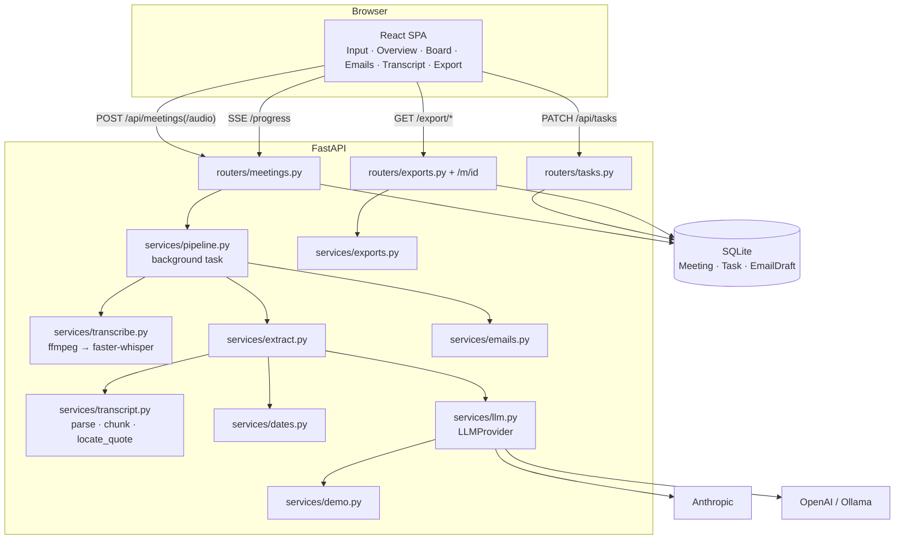

# Architecture

## Request flow

1. `POST /api/meetings` stores the meeting (`queued`) and returns `202`; a background task runs `pipeline.process_meeting`.
2. Status moves `transcribing` (audio only) → `analyzing` → `drafting` → `done` (or `error` with a user-facing message). `GET /progress` streams each change as SSE; the UI falls back to polling if SSE drops.
3. `extract.run_extraction` chunks long input, calls the provider with validation + retries, merges, verifies quotes, and resolves dates in code.
4. Action items become `Task` rows (the Kanban cards); summary, decisions, questions, risks and warnings are stored as JSON on the meeting.
5. `emails.build_all` renders a recap and one draft per owner for the chosen tone.

## Design decisions

- **Provider abstraction**: `LLMProvider.complete(system, messages)` returns text; validation, retries and parsing live once in `extract.py`, so all providers (and the demo provider) share the same safety path.
- **Demo provider**: serves pre-baked JSON for the bundled samples (filtered to the quotes present in the given text, which also works per chunk) and a conservative rule-based extractor otherwise.
- **Dates in code**: determinism, testability, and the model cannot hallucinate a calendar.
- **Evidence quotes**: the anti-hallucination feature and the source for transcript jump links.
- **SQLite + background threads**: zero-setup for judges; the pipeline updates a status column that SSE polls, so no broker is required.
- **Emails are templates** (tone-aware, deterministic). With a real provider, the opening line is optionally polished by the LLM and falls back to the template on any failure.
- **One origin in production**: FastAPI serves the built SPA, `/api`, and `/m/{id}`; Vite proxies in development.
